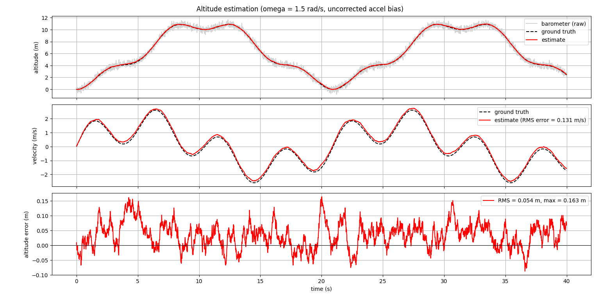
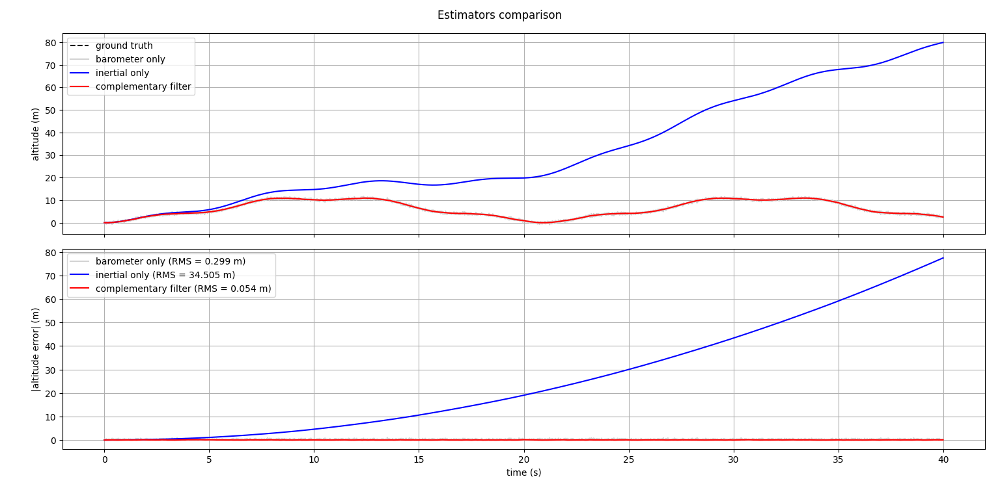
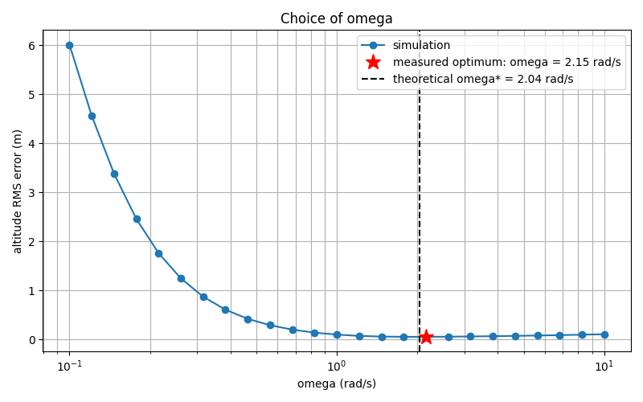
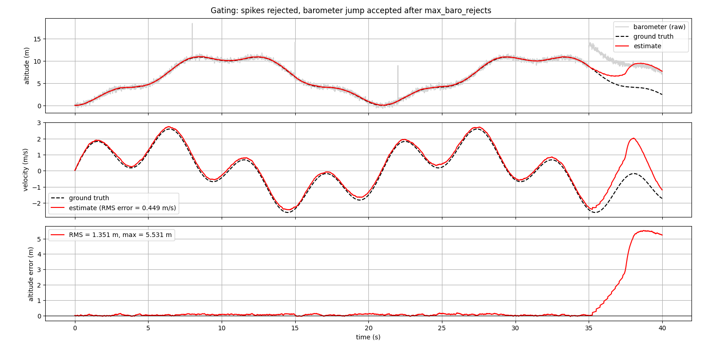

# Complementary altitude filter

Altitude and vertical velocity estimator fusing an accelerometer and a barometer. Second stage of the estimation cascade: it takes the roll and pitch from the attitude filter to project the accelerometer on the vertical.

**Principle.** Second-order complementary filter: the barometer is low-passed (reliable at low frequency, noisy at high frequency), the accelerometer is double-integrated and high-passed with a second-order filter (accurate at high frequency, drifting at low frequency). A single parameter $\omega$ sets the crossover between the two.

All the theory (barometer model, projection, derivation of the gains, choice of $\omega$, gating) is in [`formulas_altitude.md`](formulas_altitude.md).

All results below come from the synthetic test bench: simulated sensors with noise and an uncorrected accelerometer bias, perfect roll and pitch, no hardware. They validate the implementation against the model, not the model against reality.

## 1. Nominal case

- The estimate follows the ground truth despite the noisy barometer (grey).
- The vertical velocity is estimated too, which is needed later to damp the altitude control loop.
- The altitude error stays small and bounded: the uncorrected accelerometer bias only creates a constant offset $b/\omega^2$.

## 2. Comparison with single-sensor estimators

- **Inertial only**: the accelerometer bias is integrated twice, the error grows as $\tfrac12 b t^2$.
- **Barometer only**: no drift, but the noise stays. Averaging it would reduce the noise at the cost of a delay.
- **Complementary filter**: the noise is filtered without delay (the high frequencies come from the accelerometer), and no drift.

## 3. Choice of $\omega$

U-shaped curve: small $\omega$ lets the accelerometer bias through, large $\omega$ lets the barometer noise through. The measured optimum is close to the theoretical $\omega^*$ (section 7 of `formulas_altitude.md`), so it is worth computing it from the sensors' standard deviations.

## 4. Gating

Isolated aberrant pressure values (spikes) are rejected: the correction is skipped and the accelerometer takes over for a few steps.

Limits:
- A durable barometer offset (jump at the end) is first rejected, then accepted after `max_baro_rejects` steps. The barometer is the only absolute reference, so a lasting offset cannot be told from a real altitude change.
- During a long rejection, the inertial prediction drifts with the accelerometer bias.

Gating only protects against short outliers.