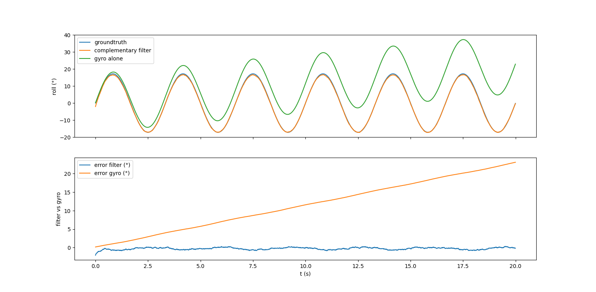
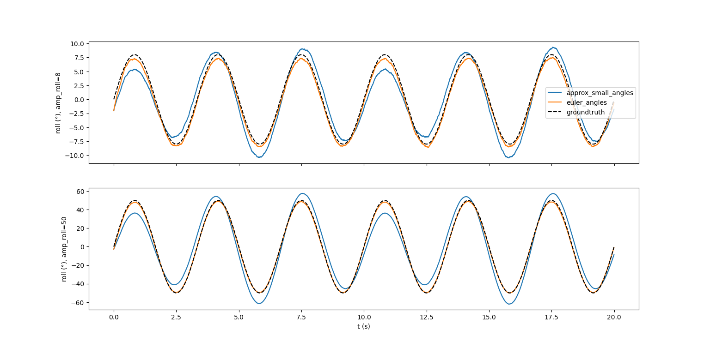

# Complementary Filter: Roll / Pitch estimation

Attitude (roll, pitch) estimation for a drone from a gyroscope and an accelerometer, with a complementary filter.
Implemented in Python and validated in simulation. 

Yaw is not estimated: with only a gyroscope and an accelerometer it is unobservable (gravity gives no heading reference, and the integrated gyro drifts without bound), and our application does not require it.

Theory and equations: see [`formulas.md`](formulas.md).

## Principle

The gyro is accurate in the short term but drifts. The accelerometer gives a drift-free tilt reference (gravity) but is noisy and corrupted by motion. The filter blends the two:

```
angle = alpha * (angle + gyro_rate * dt) + (1 - alpha) * angle_from_accelerometer
```

`alpha` dictates the influence of each sensor on the estimated solution.

## Code

| File | Component | Type | Role |
|---|---|---|---|
| `comp_filter_roll_pitch.py` | `FilterConfig` | dataclass | Filter settings: `alpha`, sensor biases, accelerometer gating threshold, `dt_max`, gyro integration method (`approx_small_angles` or `euler_angles`) |
| `comp_filter_roll_pitch.py` | `ComplementaryFilter` | class | The filter engine: `update(gyro, accel, dt)` returns the estimated roll and pitch |
| `test_bench.py` | `simulate`, `compare_methods` | functions | Simulation on a motion we define ourselves (sinusoidal roll/pitch, optional yaw rate), with simulated sensor noise and biases. `simulate`: filter vs gyro alone. `compare_methods`: small-angle approximation vs exact Euler kinematics |

## Results

### Filter vs gyro alone



Top: ground truth, complementary filter and integrated gyro (roll). Bottom: errors of the gyro and of the filter versus ground truth.
The integrated gyro drifts linearly with time because of its bias, while the filter error stays bounded around a small constant offset, as predicted (`b * tau`).

### Integration method: small angles vs exact



Roll for a small (8°) and a large (50°) motion amplitude, with a non-zero yaw rate.
The results are not too different for small angles. For large angles the small-angle approximation deviates (neglected term `yaw_rate * sin(pitch)`), while the exact Euler kinematics stays on the ground truth.

## Pros and cons

**Pros**
- Simple and cheap: easy to run on an embedded target.
- Few parameters, easy to tune and to interpret (`alpha`, biases).
- Bounded error: a constant offset `b * tau` instead of an error growing with time. With the simulated gyro bias (0.02 rad/s), `alpha = 0.98` and `dt = 5 ms`, the offset is about 0.3°, versus about 23° after 20 s for the gyro alone.
- Biases can be calibrated and subtracted, which also allows a larger `alpha` (more filtering).

**Cons / limitations**
- **Biases are not estimated online.** They are assumed constant and must be calibrated once (gyro at rest, accelerometer in 6 positions). Temperature or time drift is not tracked.
- **Only valid for low dynamics.** The accelerometer gives the tilt only if it measures gravity alone. Any sustained linear acceleration or vibration corrupts it, and a multirotor in flight mainly measures its own thrust rather than gravity. Gating falls back to the gyro alone during these phases, so drift comes back for their duration.
- Trade-off on `alpha`: more filtering means more sensitivity to the residual gyro bias.
- Yaw is unobservable (no magnetometer). The Euler angle formulation is singular at pitch = ±90°.
- Validated in simulation only, no real sensor data yet.