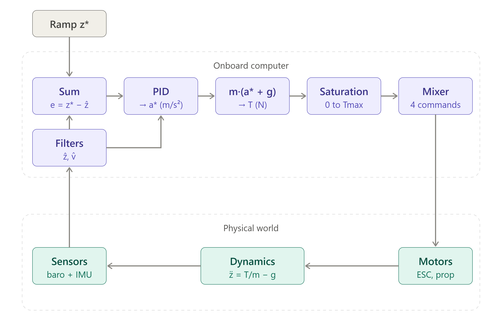
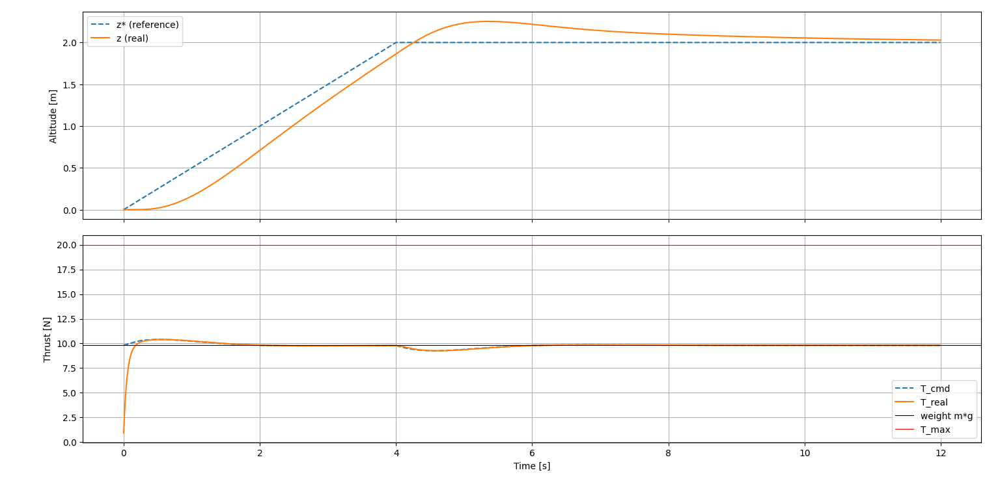

# Altitude control loop: takeoff simulation

Closed-loop simulation of the altitude control of the drone, used as a test bench and as the specification of the controller before its C++ port. The scenario is the takeoff: the drone starts on the ground and climbs to a target altitude, where it holds.

Conventions: world frame X forward, Y left, Z up; SI units; radians.

| File | Content |
|---|---|
| `loop_altitude.py` | Configs and all classes (reference, controller, motors, dynamics, sensors) |
| `simu_takeoff.py` | Simulation loop and plots |

## 1. Loop overview

The loop runs at a fixed step $\Delta t$. Purple blocks run on the onboard computer and are the part meant to be ported to C++. Green blocks only exist in the simulator: they stand for the real world.

| Block | Class | Inputs → output |
|---|---|---|
| Ramp $z^*$ | `AltitudeReference` | $t \rightarrow z^*$ |
| Sum, PID, thrust conversion, saturation | `AltitudeController` | $z^*, \hat z, \hat v \rightarrow T_{cmd}$ |
| Motors | `MotorModel` | $T_{cmd} \rightarrow T_{real}$ |
| Dynamics | `VerticalDynamics` | $T_{real} \rightarrow z, v$ (real) |
| Sensors | `Sensors` | real state → noisy measurements |
| Filters | complementary filters (separate folder) | measurements → $\hat z, \hat v$ |

The controller closes the loop on the **estimated** altitude $\hat z$ and vertical speed $\hat v$, never on the real state.

## 2. Control law

The PID outputs a desired acceleration $a^*$, converted into a thrust by inverting the vertical dynamics:

$$e = z^* - \hat z$$

$$a^* = K_p\, e + K_i \int e \, dt - K_d\, \hat v$$

$$T = m\,(a^* + g), \qquad 0 \le T \le T_{max}$$

With this conversion, the vertical dynamics $`m \ddot z = T - m g`$ reduce to $`\ddot z = a^{\ast}`$: a pure double integrator, independent of the mass. Without the integral term and for a constant $`z^{\ast}`$, the closed loop is a second-order system:

$$\ddot z + K_d\, \dot z + K_p\, z = K_p\, z^*, \qquad \omega_n = \sqrt{K_p}, \qquad \zeta = \frac{K_d}{2\sqrt{K_p}}$$

so $K_p$ and $K_d$ follow from a chosen $\omega_n$ and $\zeta$. The integral term absorbs model errors (mass, battery, motor curve).

- **Derivative on the measurement**: the D term uses the estimated speed $\hat v$ instead of differentiating the error (no noise amplification, no kick on reference changes).
- **Anti-windup**: the integral only accumulates when the thrust is not saturated, or when the error pulls the output out of saturation.
- **Reference ramp**: the altitude command is a rate-limited ramp up to the target, because a step would demand an unrealistic thrust.

## 3. Simulation model

- **Dynamics**: $m\,\ddot z = T_{real} - m\,g$, integrated exactly for a constant acceleration $a$ over a step:

$$z_{k+1} = z_k + v_k\,\Delta t + \tfrac{1}{2}\,a\,\Delta t^2, \qquad v_{k+1} = v_k + a\,\Delta t$$

  The ground is a floor: on the ground with a thrust lower than the weight, the drone stays at rest.
- **Motors**: the thrust command is saturated in $[0, T_{max}]$, then follows a first-order lag of time constant $\tau$:

$$\tau\dot T_{real} = T_{cmd} - T_{real}$$

  discretized exactly as $T_{real,k+1} = T_{real,k} + \left(1 - e^{-\Delta t/\tau}\right)\left(T_{cmd} - T_{real,k}\right)$. The motors are off at the start.
- **Sensors** (implemented, not used in the results below): accelerometer (specific force along the vertical axis, $+g$ at rest) and barometer, with white noise.

## 4. Results

Configuration used: $m = 1$ kg, $T_{max} = 20$ N, $\tau = 50$ ms, $\Delta t = 5$ ms; target altitude 2 m, climb rate 0.5 m/s; $K_p = 4$, $K_d = 2.8$ ($\omega_n = 2$ rad/s, $\zeta = 0.7$), $K_i = 1$.

| Quantity | Value |
|---|---|
| Lift-off | 0.28 s |
| Maximum tracking lag during the ramp | 0.35 m |
| Peak overshoot | 0.25 m (12.6 %) at 5.4 s |
| Within 5 % of the target (stays) | 8.0 s |
| Altitude at 12 s | 2.03 m |
| Peak thrust | 10.4 N (the saturation is never reached) |

- **Ramp lag**: while climbing at constant speed, the D term brakes, which leaves a steady error $K_d\dot z^*/K_p = 2.8 \times 0.5 / 4 = 0.35$ m. Feeding the reference speed forward would remove it.
- **Overshoot**: it comes from the integral term, which charges during this lag. Lowering $K_i$ reduces it: $K_i = 0.5$ gives 0.17 m and $K_i = 0.2$ gives 0.09 m, at the price of a slower final convergence.

## 5. Assumptions

- **Perfect measurements**: the filters are **not** included in these results: the controller receives the real $z$ and $v$ ($\hat z = z$, $\hat v = v$). The purpose is to test the control loop alone, before evaluating the effect of the estimation errors. Connecting the complementary filters is left for a next step.
- Level attitude: roll and pitch stay at zero, the motion is purely vertical (one degree of freedom).
- Constant mass and constant $T_{max}$.
- Fixed time step, no computation delay, no communication delay.

## 6. Limitations

- **Motor model**: the response of the motors is reduced to a first-order lag. It is a coherent and common approximation, but not a detailed model of a brushless motor with its propeller (rotor inertia, drag torque, different acceleration and deceleration rates, ESC behaviour). The real chain is: the flight controller sends a **throttle command** to each ESC, which switches the battery voltage into the motor phases; the motor speed $\omega$ follows the effective voltage, and the propeller produces a thrust roughly proportional to $\omega^2$. The simulation lumps all this into $T_{cmd} \rightarrow T_{real}$ and assumes the thrust command is directly the thrust produced. In reality, a calibration curve (thrust versus throttle, measured on a bench) and a battery voltage compensation are needed.
- **One thrust only**: the four motors are not modeled individually. Asymmetries (mass distribution, different motors) have no effect here; in practice the attitude loop compensates them through the mixer (differential commands), which belongs to the next step.
- **No air drag** and no ground effect.
- **Vertical dynamics only**: the attitude is not considered.
- **Ground contact**: simple floor, no landing dynamics.